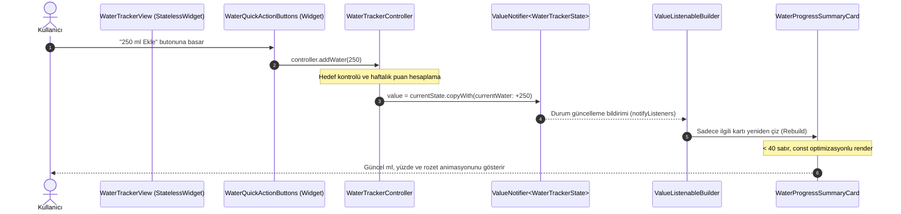

# Susadım Projesi - State Yönetimi ve Veri Akışı Referansı (State Flow)

Bu doküman, **Susadım** (akıllı su, egzersiz ve kalori takibi) uygulamasında durum yönetimi (state management), veri akışı (data flow), yaşam döngüsü (lifecycle) ve bileşenler arası iletişim kurallarını tanımlayan bağlayıcı teknik referanstır.

---

## 1. Mimari Prensipler ve Durum Yönetimi Felsefesi

Proje mimarisi; harici, ağır ve karmaşık durum yönetim paketleri (Bloc, Riverpod, MobX vb.) yerine **Dart ve Flutter'ın yerel çekirdek API'leri** (`ValueNotifier`, `ValueListenableBuilder`) üzerine kurulmuştur.

### Temel Kurallar
1. **Tek Yönlü Veri Akışı (Unidirectional Data Flow):** Veri yalnızca Controller -> View yönünde akar; kullanıcı etkileşimleri ise View -> Controller metotları üzerinden durumu günceller.
2. **Tek Doğruluk Kaynağı (Single Source of Truth):** Bir özelliğin (feature) iş mantığı ve verisi sadece ilgili `Controller` sınıfı içinde tutulur. UI katmanında iş mantığı ve doğrudan durum manipülasyonu bulunamaz.
3. **Sayfa Düzeyinde `setState` Yasağı:** Sayfa (`_view.dart`) seviyesinde asla `setState` kullanılmaz. Sayfalar `StatelessWidget` olarak tanımlanır. Yerel durum değişiklikleri (örneğin buton animasyonu, yerel text controller) gerekmedikçe `StatefulWidget` açılmaz.
4. **Hafıza Yönetimi ve Temizlik (`dispose` Zorunluluğu):** Her `ValueNotifier` nesnesi, dinleyicisi kalmadığında veya controller yaşam döngüsü bittiğinde `dispose()` edilerek bellek sızıntıları (memory leak) önlenir.
5. **Küçük ve Odaklı Yapı (40 Satır Kuralı):** 40 satırı geçen `build` metotları yasaktır. UI parçalanarak bağımsız widget'lara (`_widget.dart` / `_card.dart`) ayrılır.

---

## 2. Mimari Katmanlar ve Sorumluluk Dağılımı

Her özellik modülü (`lib/features/<feature_name>/`) 4 temel katmandan meydana gelir:

```text
lib/features/<feature_name>/
├── controller/
│   └── <feature_name>_controller.dart   # İş mantığı, reaktif durum (ValueNotifier), dispose
├── models/
│   └── <feature_name>_model.dart        # Değişmez (immutable) veri modelleri, copyWith, JSON
├── view/
│   └── <feature_name>_view.dart         # Sayfa iskeleti, ValueListenableBuilder, < 40 satır build
└── widget/
    └── <feature_name>_card.dart         # Modüler, yeniden kullanılabilir ve const alt bileşenler
```

### Katman Sorumlulukları
| Katman | Sorumluluk | İzin Verilenler | Yasak Olanlar |
| :--- | :--- | :--- | :--- |
| **Model** | Veri tanımı, serileştirme | `const` constructor, `copyWith`, `fromJson`, `toJson`, `props` | UI bağımlılığı (`BuildContext`), iş mantığı, mutable alanlar |
| **Controller** | İş mantığı, durum tutma | `ValueNotifier<T>`, hesaplamalar, servis çağrıları, `dispose()` | `BuildContext`, `Widget` döndürme, UI importları |
| **View** | Sayfa iskeleti, layout | `StatelessWidget`, `ValueListenableBuilder`, `Theme.of(context)` | Ağır `setState`, 40 satırı aşan build metodu, doğrudan veri manipülasyonu |
| **Widget** | Atomik/Moleküler UI parçası | `StatelessWidget`, `const` constructor, tema tokenları | Controller iç mantığını yeniden yazmak, bağımsız iş akışları başlatmak |

---

## 3. Reaktif Durum Akış Şeması

Aşağıdaki şema, kullanıcının su ekleme aksiyonundan başlayarak rozet ve haftalık hayvan ödülü kilidinin açılmasına kadar olan tam döngüyü göstermektedir:



---

## 4. Kod Standartları ve Uygulama Şablonları

### 4.1. Model Katmanı Şablonu (`models/<feature_name>_model.dart`)
Tüm modeller **değişmez (immutable)** olmalıdır:

```dart
import 'package:flutter/foundation.dart';

@immutable
class WaterTrackerModel {
  final int currentWaterMl;
  final int dailyGoalMl;
  final int weeklyPoints;
  final bool isGoalAchieved;
  final String? unlockedPetName;

  const WaterTrackerModel({
    required this.currentWaterMl,
    required this.dailyGoalMl,
    required this.weeklyPoints,
    required this.isGoalAchieved,
    this.unlockedPetName,
  });

  /// Başlangıç varsayılan durumu
  factory WaterTrackerModel.initial() {
    return const WaterTrackerModel(
      currentWaterMl: 0,
      dailyGoalMl: 2000,
      weeklyPoints: 0,
      isGoalAchieved: false,
      unlockedPetName: null,
    );
  }

  /// İmmutable güncelleme metodu
  WaterTrackerModel copyWith({
    int? currentWaterMl,
    int? dailyGoalMl,
    int? weeklyPoints,
    bool? isGoalAchieved,
    String? unlockedPetName,
  }) {
    return WaterTrackerModel(
      currentWaterMl: currentWaterMl ?? this.currentWaterMl,
      dailyGoalMl: dailyGoalMl ?? this.dailyGoalMl,
      weeklyPoints: weeklyPoints ?? this.weeklyPoints,
      isGoalAchieved: isGoalAchieved ?? this.isGoalAchieved,
      unlockedPetName: unlockedPetName ?? this.unlockedPetName,
    );
  }

  /// JSON dönüşümleri
  factory WaterTrackerModel.fromJson(Map<String, dynamic> json) {
    return WaterTrackerModel(
      currentWaterMl: json['currentWaterMl'] as int? ?? 0,
      dailyGoalMl: json['dailyGoalMl'] as int? ?? 2000,
      weeklyPoints: json['weeklyPoints'] as int? ?? 0,
      isGoalAchieved: json['isGoalAchieved'] as bool? ?? false,
      unlockedPetName: json['unlockedPetName'] as String?,
    );
  }

  Map<String, dynamic> toJson() {
    return {
      'currentWaterMl': currentWaterMl,
      'dailyGoalMl': dailyGoalMl,
      'weeklyPoints': weeklyPoints,
      'isGoalAchieved': isGoalAchieved,
      'unlockedPetName': unlockedPetName,
    };
  }

  @override
  bool operator ==(Object other) {
    if (identical(this, other)) return true;
    return other is WaterTrackerModel &&
        other.currentWaterMl == currentWaterMl &&
        other.dailyGoalMl == dailyGoalMl &&
        other.weeklyPoints == weeklyPoints &&
        other.isGoalAchieved == isGoalAchieved &&
        other.unlockedPetName == unlockedPetName;
  }

  @override
  int get hashCode => Object.hash(
        currentWaterMl,
        dailyGoalMl,
        weeklyPoints,
        isGoalAchieved,
        unlockedPetName,
      );
}
```

### 4.2. Controller Katmanı Şablonu (`controller/<feature_name>_controller.dart`)
İş mantığı ve durum burada kapsüllenir:

```dart
import 'package:flutter/foundation.dart';
import '../models/water_tracker_model.dart';

class WaterTrackerController {
  /// Reaktif durum nesnesi
  final ValueNotifier<WaterTrackerModel> state =
      ValueNotifier<WaterTrackerModel>(WaterTrackerModel.initial());

  WaterTrackerModel get current => state.value;

  /// Su tüketimi ekleme aksiyonu
  void addWater(int amountMl) {
    if (amountMl <= 0) return;

    final newWater = current.currentWaterMl + amountMl;
    final isAchieved = newWater >= current.dailyGoalMl;
    
    // Her 250ml için 10 haftalık puan, hedef tamamlandığında ek 50 bonus puan
    final additionalPoints = (amountMl ~/ 25) + (isAchieved && !current.isGoalAchieved ? 50 : 0);
    final newPoints = current.weeklyPoints + additionalPoints;

    // Haftalık puana göre hediye hayvan kilit açılışı (Örn: 500 puanda "Su Samuru")
    String? pet = current.unlockedPetName;
    if (newPoints >= 500 && pet == null) {
      pet = 'Akıllı Su Samuru';
    }

    state.value = current.copyWith(
      currentWaterMl: newWater,
      weeklyPoints: newPoints,
      isGoalAchieved: isAchieved,
      unlockedPetName: pet,
    );
  }

  /// Günlük sayacı sıfırlama aksiyonu
  void resetWater() {
    state.value = current.copyWith(
      currentWaterMl: 0,
      isGoalAchieved: false,
    );
  }

  /// Günlük hedef güncelleme
  void updateDailyGoal(int newGoalMl) {
    if (newGoalMl <= 0) return;
    state.value = current.copyWith(
      dailyGoalMl: newGoalMl,
      isGoalAchieved: current.currentWaterMl >= newGoalMl,
    );
  }

  /// Bellek sızıntılarını önlemek için yaşam döngüsü sonlandırma
  void dispose() {
    state.dispose();
  }
}
```

### 4.3. View Katmanı Şablonu (`view/<feature_name>_view.dart`)
Tüm `build` fonksiyonları 40 satırın altındadır; alt widget'lar ayrı dosyalara veya özel `StatelessWidget` sınıflarına bölünür:

```dart
import 'package:flutter/material.dart';
import '../controller/water_tracker_controller.dart';
import '../models/water_tracker_model.dart';
import '../widget/water_progress_card.dart';
import '../widget/water_quick_actions.dart';

class WaterTrackerView extends StatefulWidget {
  const WaterTrackerView({super.key});

  @override
  State<WaterTrackerView> createState() => _WaterTrackerViewState();
}

class _WaterTrackerViewState extends State<WaterTrackerView> {
  late final WaterTrackerController _controller;

  @override
  void initState() {
    super.initState();
    _controller = WaterTrackerController();
  }

  @override
  void dispose() {
    _controller.dispose();
    super.dispose();
  }

  @override
  Widget build(BuildContext context) {
    // KURAL: build metodu 40 satırı geçemez!
    return Scaffold(
      appBar: AppBar(
        title: const Text('Susadım - Su Takibi'),
        centerTitle: true,
      ),
      body: SafeArea(
        child: ValueListenableBuilder<WaterTrackerModel>(
          valueListenable: _controller.state,
          builder: (context, data, _) {
            return SingleChildScrollView(
              padding: const EdgeInsets.all(16.0),
              child: Column(
                crossAxisAlignment: CrossAxisAlignment.stretch,
                children: [
                  WaterProgressCard(data: data),
                  const SizedBox(height: 16),
                  WaterQuickActions(
                    onAddWater: _controller.addWater,
                    onReset: _controller.resetWater,
                  ),
                ],
              ),
            );
          },
        ),
      ),
    );
  }
}
```

---

## 5. Tema Mimarisi Entegrasyonu (`ThemeController`)

Proje gereksinimi olan Aydınlık (Açık Enerji & Spor) ve Karanlık (Dark Obsidian & Neon) modları da `ValueNotifier` ile yönetilir:

```mermaid
flowchart LR
    SettingsUI[Ayarlar Ekranı / Sistem Olayı] -->|setThemeMode| ThemeCtrl[ThemeController (ValueNotifier)]
    ThemeCtrl -->|notifyListeners| MaterialAppBuilder[ValueListenableBuilder in main.dart]
    MaterialAppBuilder -->|themeMode| MaterialApp[MaterialApp (Light / Dark AppTheme)]
```

- Renkler ve tipografi asla widget içinde hardcoded verilmez (`Color(0xFF...)` yasaktır).
- Daima `Theme.of(context).colorScheme` ve `Theme.of(context).textTheme` kullanılır.

---

## 6. Sık Yapılan Hatalar (Anti-Patterns) ve Doğruları

| Hatalı Yaklaşım (YASAK) | Doğru Yaklaşım (STANDART) | Gerekçe |
| :--- | :--- | :--- |
| Sayfa genelinde `setState(() {})` çağırmak | `ValueNotifier` ve `ValueListenableBuilder` ile hedef widget'ı dinlemek | Gereksiz tüm sayfa render'ını önler, performansı 60/120 FPS tutar. |
| `controller.dispose()` çağırmamak | `StatefulWidget.dispose` içinde veya DI konteynerinde `dispose()` tetiklemek | Bellek sızıntılarını (memory leaks) engeller. |
| 40 satırı aşan dev `build` metotları yazmak | UI parçalarını bağımsız `StatelessWidget` sınıflarına bölmek | Kod okunabilirliği, yeniden kullanılabilirlik ve widget ağacı optimizasyonu. |
| Widget içine `TextStyle(color: Colors.blue)` yazmak | `Theme.of(context).colorScheme.primary` kullanmak | Karanlık ve aydınlık tema uyumunu garanti eder. |
| Harici ağır paket (MobX, Bloc) eklemek | Yerel Flutter `ValueNotifier` mimarisini sürdürmek | Paket boyutunu küçültür, bağımlılık riskini ve build sürelerini azaltır. |

---

## 7. Doğrulama ve Test Adımları

Yapılan her durum akışı değişikliğinden sonra aşağıdaki doğrulama adımları çalıştırılmalıdır:

1. **Statik Kod Analizi (0 hata, 0 uyarı şart):**
   ```bash
   flutter analyze
   ```
2. **Controller Birim Testleri:**
   ```bash
   flutter test test/features/<feature_name>/
   ```
